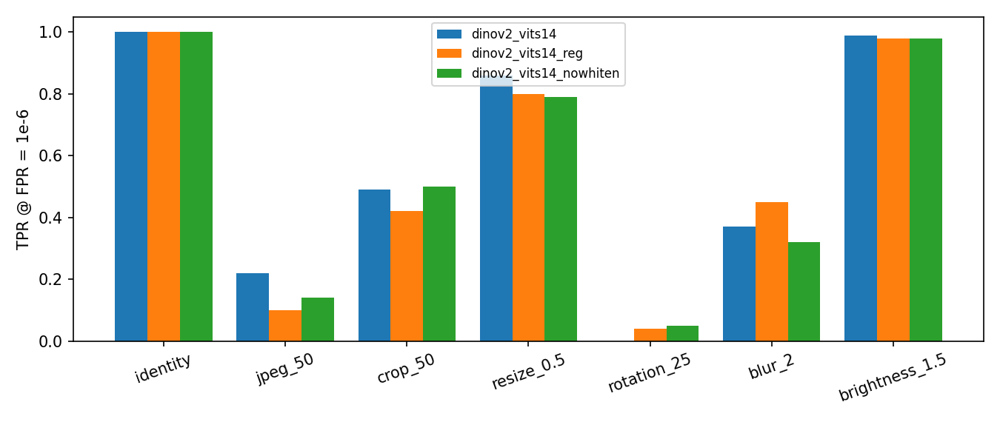
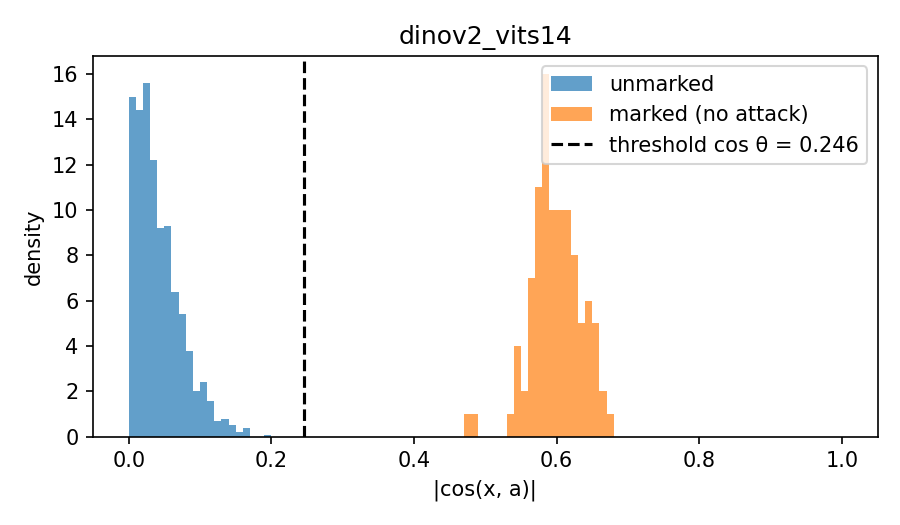
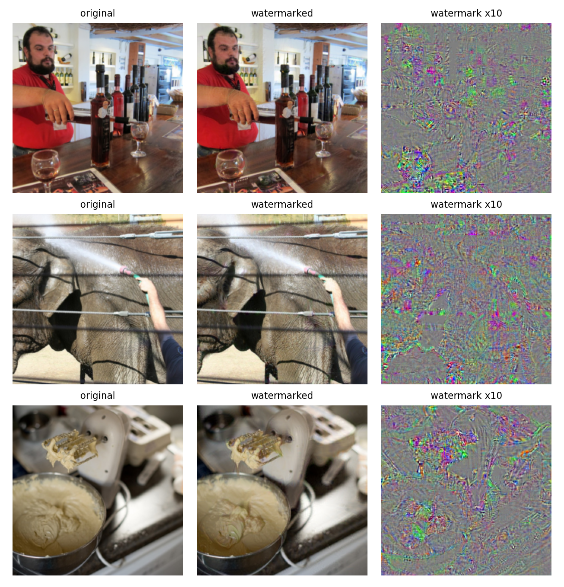

# Watermarking images in DINOv2 latent spaces

A small, self-contained reproduction of the zero-bit method of
**Fernandez et al., *Watermarking Images in Self-Supervised Latent Spaces*, ICASSP 2022**
([arXiv:2112.09581](https://arxiv.org/abs/2112.09581), [official code](https://github.com/facebookresearch/ssl_watermarking)),
re-run with modern self-supervised encoders.

**Research question.** Are modern SSL encoders (DINOv2) good watermarking spaces, and do
*registers* (DINOv2-reg) change the robustness of the watermark?

## 1. Motivation

Classic watermarking hides a signal in a hand-crafted transform domain (DCT, DFT, wavelets).
Fernandez et al. replace the transform by a frozen self-supervised network: SSL features are
trained to be *invariant to data augmentation*, which is exactly the robustness a watermark needs,
and they come "for free", with no encoder/decoder trained for watermarking. The original paper
uses a ResNet-50 trained with DINO (d = 2048). This repo asks whether the idea transfers to
DINOv2 ViTs, whose features are much stronger for retrieval but which were never trained with
rotation augmentation, and whether the register tokens of DINOv2-reg, which clean up the
attention maps, also make the CLS token a better place to hide a mark.

## 2. Method (zero-bit)

```
                      secret key a (unit vector in R^d), threshold cos θ from the target FPR
                                               │
 image I ──► + w ──► random differentiable ──► DINOv2 (frozen) ──► PCA-whitening ──► x ──► loss(x, a)
   │          ▲      augmentation              CLS token, d=384                              │
   │          │                                                                              │
   │   w = psnr_clip(H ⊙ δ)  ◄────────────── Adam on δ (100 steps) ◄───── backprop to pixels ┘
   │          H = texture map of I
   ▼
 watermarked image  I_w = round(I + w)   ──► attacks (JPEG, crop, ...) ──► x ──► detect: |cos(x, a)| > cos θ
```

**Feature space.** φ(I) = whiten(DINOv2(normalize(I))), the CLS token of ViT-S/14 (d = 384)
followed by PCA-whitening learned on unmarked images, so that natural features are centered with
identity covariance and no direction of R^d is privileged.

**Detection region (dual hypercone).** With a secret unit key `a`:

$$\mathcal{D} = \{x \in \mathbb{R}^d : |x^\top a| > \|x\|\cos\theta\}$$

**Threshold from the false positive rate.** If a natural feature has a uniformly random direction,

$$\mathrm{FPR} = P(|\cos(x, a)| > \cos\theta) = 1 - I_{\cos^2\theta}\left(\tfrac12, \tfrac{d-1}{2}\right)
\;\Rightarrow\; \cos\theta = \sqrt{I^{-1}\left(\tfrac12, \tfrac{d-1}{2}, 1-\mathrm{FPR}\right)}$$

where I is the regularized incomplete Beta function (`scipy.special.betaincinv`).
For d = 384 and FPR = 1e-6 this gives **cos θ = 0.246** (it is 0.108 for d = 2048 in the paper:
lower dimension forces a narrower cone, i.e. a harder target).

**Marking loss** (the opposite of the "robustness estimate" of Cox et al.):

$$\mathcal{L}_w(x) = -\left[(x^\top a)^2 - \|x\|^2\cos^2\theta\right]$$

It is positive outside the cone and keeps decreasing as x moves deeper inside, which buys a margin
against attacks.

**Imperceptibility.** The perturbation actually added is `w = psnr_clip(H ⊙ δ, 40 dB)`.
`H` is a texture map (local 7×7 standard deviation, normalized to [0, 1]), a simplified version of
the paper's SSIM attenuation that hides the mark in textured regions; `psnr_clip` rescales `w` if
its PSNR drops below the target. The final image is rounded to 8-bit pixels.

**Robustness.** At each of the 100 Adam steps (lr = 0.01), the watermarked image goes through one
random *differentiable* augmentation (identity, rotation ±30°, crop 50–100 %, resize 0.5–1,
Gaussian blur, horizontal flip), so the feature is pushed into the cone for all these views.

## 3. Code organization

One file per step of the method, readable top to bottom:

| file | role |
|---|---|
| `src/data.py` | download COCO val2017, build disjoint splits, load images as 224×224 tensors in [0, 1] |
| `src/encoder.py` | frozen DINOv2 (CLS token), ImageNet normalization, PCA-whitening (fit + apply) |
| `src/augmentations.py` | **differentiable** augmentations used *during marking* (gradients flow through them) |
| `src/watermark.py` | secret key, threshold cos θ from the FPR, texture map, `psnr_clip`, loss, marking loop |
| `src/attacks.py` | attacks applied *at evaluation*, after publication (incl. real, non-differentiable JPEG) |
| `src/evaluate.py` | detection, TPR per attack, false positive check, results table and figures |
| `main.py` | runs the whole experiment for one model and appends a row to `results/results.csv` |

`augmentations.py` and `attacks.py` are deliberately separate: the first is *what we train the
mark against* (must be differentiable), the second is *what the image suffers in the wild* (no
gradients needed, and it includes edits never seen at marking time, like JPEG and brightness).

## 4. How to run

**Data.** COCO val2017 (5 000 images, ~800 MB) is downloaded automatically into `data/`.
Splits are disjoint and fixed by the seed: 3 900 images to fit the whitening, 100 images to
watermark, 1 000 unmarked images to check false positives.

### Locally

```bash
pip install -r requirements.txt
python main.py --model dinov2_vits14 --debug          # 5 images, sanity check (results/debug/)
python main.py --model dinov2_vits14
python main.py --model dinov2_vits14_reg
python main.py --model dinov2_vits14 --no_whitening   # ablation
```

### In Google Colab (free T4 GPU)

`Runtime > Change runtime type > T4 GPU`, then in a cell:

```python
!git clone https://github.com/yassine11102003/ssl-watermarking-dinov2.git
%cd ssl-watermarking-dinov2
!pip install -r requirements.txt
!python main.py --model dinov2_vits14 --debug
!python main.py --model dinov2_vits14
!python main.py --model dinov2_vits14_reg
!python main.py --model dinov2_vits14 --no_whitening
```

Each full run takes a few minutes on a T4 (≈ 50 min on a laptop CPU). The GPU is used automatically
when available. Main options: `--n_mark 100 --n_whiten 3900 --n_negative 1000 --psnr 40 --fpr 1e-6
--iters 100 --lr 0.01 --seed 0 --data_dir data --out_dir results`.

## 5. Results

Setup: 100 COCO images at 224×224, target PSNR 40 dB, FPR = 1e-6 (cos θ = 0.246), 100 Adam steps,
seed 0, Colab T4. TPR = fraction of the 100 marked images still detected after the attack
(with 100 images, a TPR around 0.5 has a standard error of about ±0.05).

| run | identity | JPEG 50 | crop 50 % | resize ×0.5 | rotation 25° | blur σ=2 | brightness ×1.5 | PSNR (dB) | false pos. | mean \|cos\| unmarked | mean \|cos\| marked |
|---|---|---|---|---|---|---|---|---|---|---|---|
| DINOv2 ViT-S/14 | **1.00** | **0.22** | 0.49 | **0.86** | 0.00 | 0.37 | **0.99** | 39.95 | 0/1000 | 0.038 | 0.599 |
| DINOv2 ViT-S/14-reg | **1.00** | 0.10 | 0.42 | 0.80 | 0.04 | **0.45** | 0.98 | 39.95 | 0/1000 | 0.039 | 0.613 |
| DINOv2 ViT-S/14, no whitening | **1.00** | 0.14 | **0.50** | 0.79 | 0.05 | 0.32 | 0.98 | 39.95 | 0/1000 | 0.039 | 0.636 |

Attacks seen (in some form) at marking time: crop, resize, rotation, blur. Never seen: JPEG, brightness.

**TPR per attack**



**Distribution of |cos(x, a)|** (1 000 unmarked vs. 100 marked images, DINOv2 ViT-S/14).
Natural images stay far below the threshold, marked images are pushed well inside the cone.



**Examples** (original / watermarked at 40 dB / watermark amplified ×10). The texture mask concentrates
the signal on edges and textured regions, where it is hardest to see; smooth areas receive much less.



## 6. Observations

1. **DINOv2 is a valid zero-bit watermarking space.** Without attack, every marked image is
   detected (TPR = 1.00) at 40 dB, while none of the 1 000 unmarked images crosses the threshold:
   unmarked |cos| ≈ 0.04, marked ≈ 0.6, threshold 0.246. The empirical PSNR (39.95 dB) matches the
   target up to the final 8-bit rounding.
2. **Robustness is uneven and follows the invariances of the encoder.** Photometric changes are
   almost free: brightness ×1.5 keeps TPR ≈ 0.98, although it was never seen during marking,
   because DINOv2 is trained with color jittering. Resizing is also well tolerated (0.80–0.86).
   Crop and blur are only partly survived (0.3–0.5). JPEG 50 (0.10–0.22) and rotation 25°
   (≤ 0.05) mostly break the mark. The x10 maps show why JPEG hurts: the optimized signal is
   high-frequency, which is precisely what JPEG quantization removes.
3. **Rotation needs invariance in the encoder, not only in the marking.** We train the mark against
   ±30° rotations and it still fails at 25°. This matches Fig. 3 of the paper: rotation robustness
   requires rotation augmentation both at marking *and* at pre-training (their DINO ResNet-50 was
   trained with rotations). DINOv2 never was, and a patch-based ViT is far from rotation invariant.
4. **Registers do not change the picture, and neither does whitening.** DINOv2-reg is slightly
   better on blur (+0.08) and worse on JPEG (−0.12) and crop (−0.07). These gaps are about one to two
   standard errors at n = 100, so they read as noise rather than a systematic effect. That fits a
   simple reading: registers clean up the *patch* tokens and attention maps, while we only use the
   global CLS token. Removing PCA-whitening gives a deeper cone at identity (|cos| 0.636 vs. 0.599)
   but slightly lower TPR on JPEG, resize and blur, so whitening helps a little; it matters less than
   in the paper, where it was introduced to fix the anisotropy of the DINO ResNet-50 features.

Overall, scores are well below the paper's (e.g. JPEG 50: 0.81 on YFCC, rotation 25°: 0.97). The
main suspects: a 5× smaller feature space (cos θ = 0.246 vs. 0.108, a much narrower cone), 224×224
images instead of full resolution (fewer pixels to carry the mark), and no rotation in the
encoder's pre-training.

## 7. Limitations

- **Marking is slow**: 100 forward/backward passes per image, versus a single forward pass for
  encoder/decoder methods like HiDDeN.
- **d = 384 vs. 2048** in the paper: a smaller space means a narrower detection cone
  (cos θ = 0.246 vs. 0.108 at FPR = 1e-6) and less room to hide the signal.
- **Small scale**: 100 marked images (TPR resolution 0.01) at 224×224 only; the FPR check over
  1 000 images can only show that the FPR is not grossly above 1e-3, not that it equals 1e-6.
- **Simplified perceptual mask**: local standard deviation instead of the paper's SSIM heatmap.
- **No security study**: an attacker who knows the method can estimate the key or run an
  adversarial attack on the public encoder to remove (or forge) the mark.
- Zero-bit only (no multi-bit message decoding).

## Reference

```bibtex
@inproceedings{fernandez2022watermarking,
  title     = {Watermarking Images in Self-Supervised Latent Spaces},
  author    = {Fernandez, Pierre and Sablayrolles, Alexandre and Furon, Teddy and J{\'e}gou, Herv{\'e} and Douze, Matthijs},
  booktitle = {ICASSP},
  year      = {2022}
}
```

DINOv2: Oquab et al., *DINOv2: Learning Robust Visual Features without Supervision*, 2023.
Registers: Darcet et al., *Vision Transformers Need Registers*, ICLR 2024.
